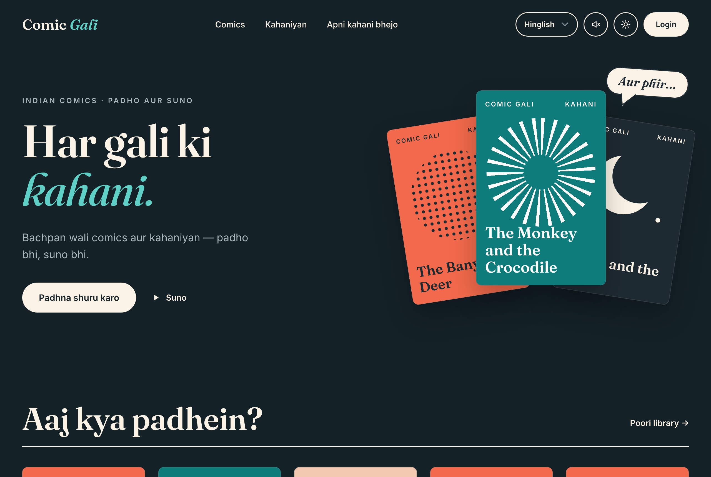
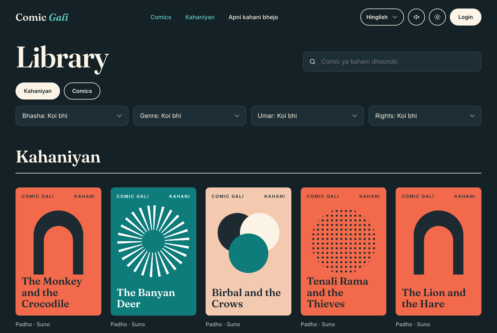
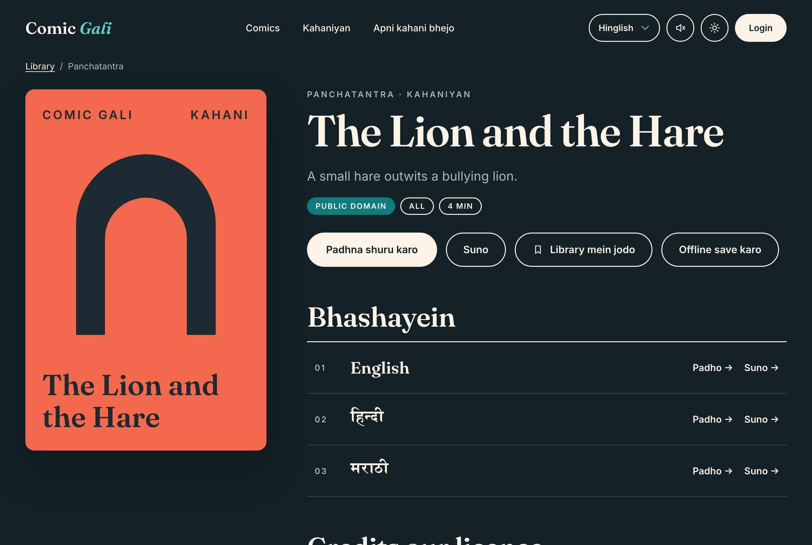
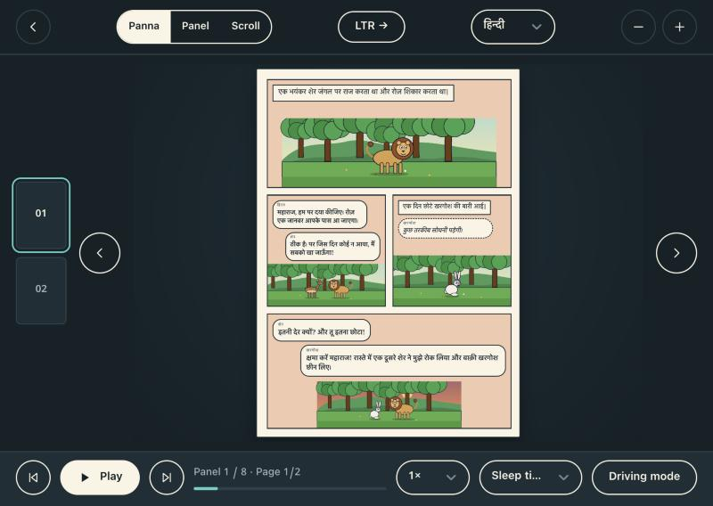
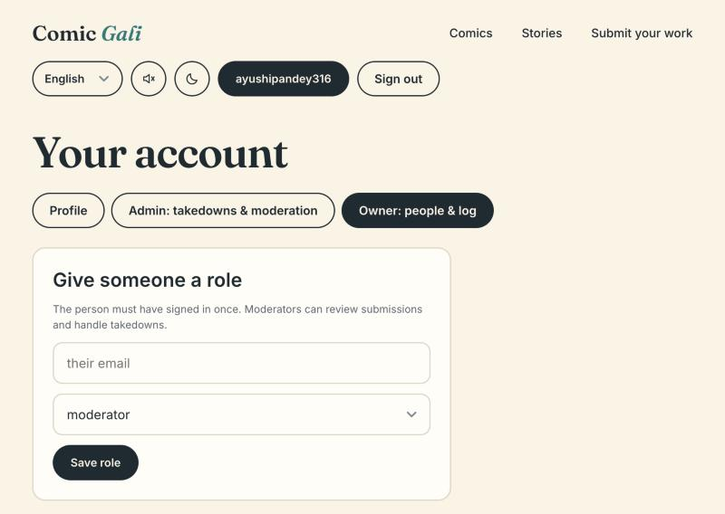

# Comic Gali

**Har gali ki ek kahani.** A home for Indian comics and illustrated stories you can **read and listen to**, in ten languages: English, Hindi, Marathi, Tamil, Telugu, Bengali, Gujarati, Kannada, Malayalam and Punjabi.

**Live site:** https://comic-gali.pages.dev



## What it does

- **Read** each story page by page, panel by panel, or as a vertical scroll. Left-to-right or right-to-left. Keyboard, swipe and pinch supported.
- **Listen** with a queue, speed control, panel skip, sleep timer, auto-advance and a driving mode.
- **11 original illustrated stories** from the Panchatantra, Jataka, Akbar–Birbal, Tenali Rama and Vikram–Betaal traditions, drawn as SVG and retold in the project's own words. Every title shows its credit, source and licence.
- **Accounts** with email link or Google sign-in. Favourites and reading positions sync between devices.
- **Submit your own work.** Creators send a story, a moderator reviews it, and approved work is published.
- **Admin portal** on the account page for moderators and the site owner (see below).
- **Offline and installable.** A service worker and web manifest let readers save stories and add the site to a phone's home screen.
- **Light and dark mode**, skip link, labelled controls, focus rings and reduced-motion support.

| Library | Story page |
| --- | --- |
|  |  |

### Reader

Panel-by-panel reading with language switching, playback controls and a page strip. This is *The Lion and the Hare* in Hindi.



### Admin portal

Anyone signed in gets an account page. Moderators also see an **Admin** tab for takedown requests, the submission review queue and audio uploads. The site owner also gets an **Owner** tab to give people roles and read the activity log.



| Role | Can do |
| --- | --- |
| reader | read, listen, sync favourites |
| creator | everything above, submit stories, upload recordings for their own titles |
| moderator | review submissions, handle takedown requests, unpublish titles, upload recordings for any title |
| admin (owner) | everything above, plus set roles and read the audit log |

All permission checks run on the server (`functions/_lib/perms.ts`). Hiding a tab in the UI is only a courtesy. The owner account cannot be demoted, and an admin cannot demote themselves.

## Tech

React 18, TypeScript and Vite on the front end. The backend is optional and runs on the Cloudflare free tier: Pages Functions, D1 (SQLite), Turnstile for anti-spam and Resend for email. Without it the whole site runs as a static build.

## Run it

```bash
npm install
npm run dev        # http://localhost:5173, static mode
npm test           # reader, audio queue, voices, audio pipeline, backend validators and the submit → approve → publish flow
npm run build      # type-check, validate content, production build into dist/
npm run preview    # serve dist/ on :4173 (the service worker only runs in a production build)
```

Node 22.5 or newer (the backend tests use `node:sqlite`). CI uses Node 24.

### Run it with the backend locally

```bash
cp .dev.vars.example .dev.vars          # then fill in SESSION_SECRET and ADMIN_EMAIL
npx wrangler d1 migrations apply comic-gali --local
VITE_API=1 npm run build
npx wrangler pages dev dist
```

With `SITE_ORIGIN` set to `http://localhost:8788`, sign-in links are printed in the server console instead of being emailed. Full setup, including secrets, Google sign-in and the free-tier limits, is in [docs/BACKEND.md](docs/BACKEND.md).

## Project layout

| Area | Where |
| --- | --- |
| Pages: home, library, title, reader, listen, sign-in, account, submit, moderation, takedown, sources | `src/pages/` |
| Reader (page-flip, panel, scroll; LTR and RTL) | `src/pages/Reader.tsx`, `src/lib/reader-state.ts` |
| Listening (queue, speed, sleep timer, driving mode) | `src/lib/audio-queue.ts`, `src/lib/speech.ts`, `src/lib/useListen.ts`, `src/components/Driving.tsx` |
| Original SVG art | `src/art/` |
| Stories (authoring format) | `content-src/stories/*.mjs` → `public/content/stories/*.json` |
| Catalog (rights, credits, licences) | `scripts/make-catalog.mjs` → `content-src/catalog.json` → `public/content/catalog.json` |
| Backend API | `functions/api/[[path]].ts`, `functions/_lib/` |
| Database schema | `migrations/` |
| Offline and PWA | `public/sw.js`, `public/manifest.webmanifest`, `src/lib/offline.ts` |
| Generated voices | `scripts/generate-audio.mjs`, `content-src/voices.json`, `content-src/lexicon/` |
| Native-speaker review | `/review/<title>?lang=xx` (`src/pages/Review.tsx`) |
| Docs | `SOURCES.md`, `DECISIONS.md`, `LICENSING/`, `docs/` |

## Adding a story

1. Copy `content-src/stories/lion-hare.mjs`. Each panel has a scene (`bg`, `actors`), alt text and lines with text for every listed language. A story is two pages of four panels.
2. Add an entry to `scripts/make-catalog.mjs` (credits, licence, source) and run `node scripts/make-catalog.mjs`.
3. Run `npm run content`. It checks that every line has text in every listed language, then writes the JSON.

Available characters and backgrounds are listed in `src/art/characters.tsx` and `src/art/Scene.tsx`.

### Audio

The player prefers a recorded file in `line.audio[lang]` over the device voice. Generate natural voices once, locally, and commit them:

```bash
npm run audio -- --dry-run                       # plan, no model needed
npm run audio:compare                            # same 3 lines per language per model, listen and pick
npm run audio -- --story lion-hare --lang hi     # idempotent; unchanged lines are never regenerated
npm run content                                  # patches audio URLs into the story JSON
```

This needs ffmpeg and Indic Parler-TTS (setup at the top of `scripts/tts/parler_synth.py`). Pronunciation fixes live in `content-src/lexicon/<story>.json`.

## Deploy

- **Static only:** any static host. Build with `npm run build` and publish `dist`. No environment variables needed.
- **With the backend:** Cloudflare Pages plus D1. Set `VITE_API=1` at build time and follow [docs/BACKEND.md](docs/BACKEND.md). Never commit real secrets; `.dev.vars` is git-ignored.
- **CI and deploy:** `.github/workflows/ci.yml` validates content, runs the tests, builds and checks the audio manifest. On a push to `main` it then deploys to Cloudflare Pages, once the repository has `CLOUDFLARE_API_TOKEN` and `CLOUDFLARE_ACCOUNT_ID` secrets. Without them the deploy step is skipped.

## Keyboard (reader)

Arrows, Space, PageUp and PageDown turn the page (arrows swap in RTL). `+`, `-` and `0` zoom. `m` changes mode. `l` or `p` plays or pauses listening.

## Content and licensing

Stories are traditional tales retold in the project's own words, with original artwork. Text and art are released under CC BY 4.0. Commercial comics and magazines listed as "coming soon" are shown only as placeholders until a licence is agreed; the correspondence notes are in `LICENSING/`. Every source is recorded in `SOURCES.md`. Rights holders can use the takedown form on the site, and moderators act on it from the account page.
